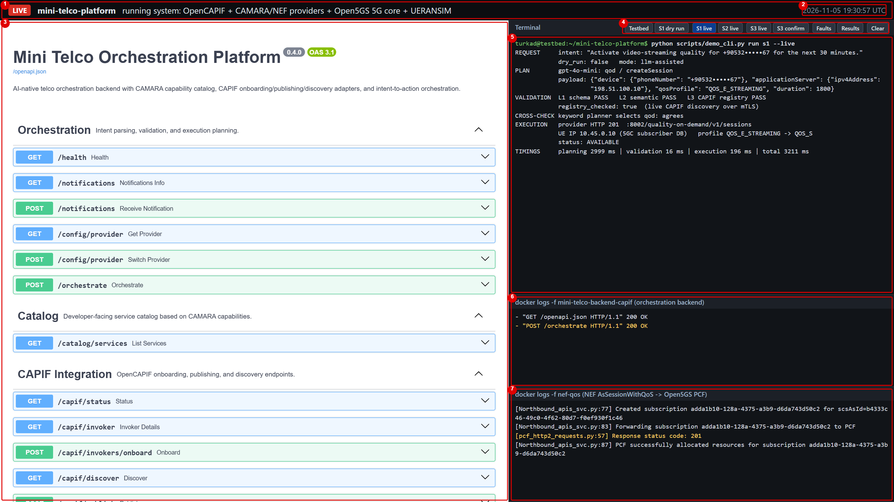
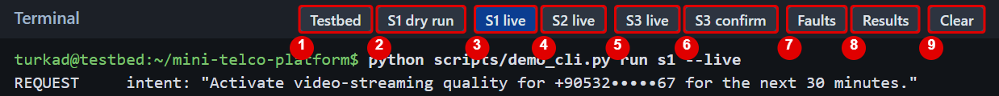
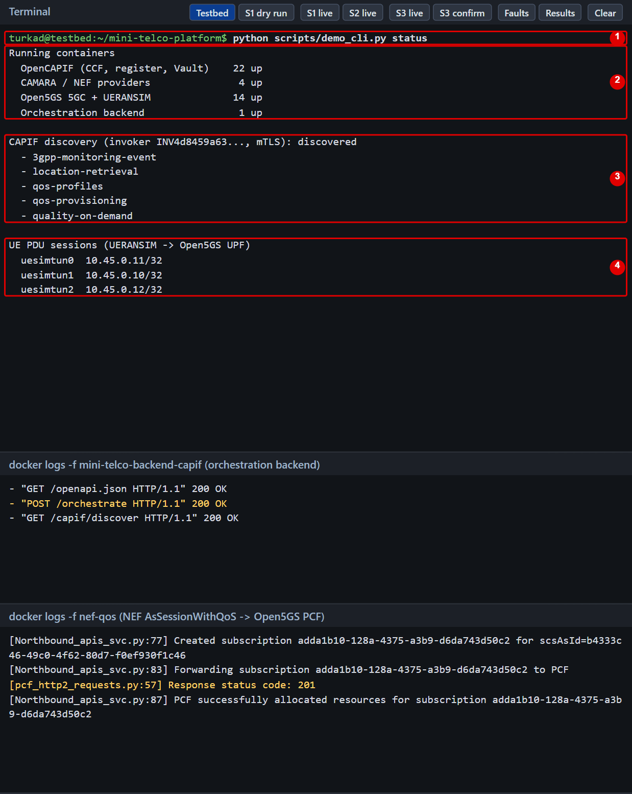
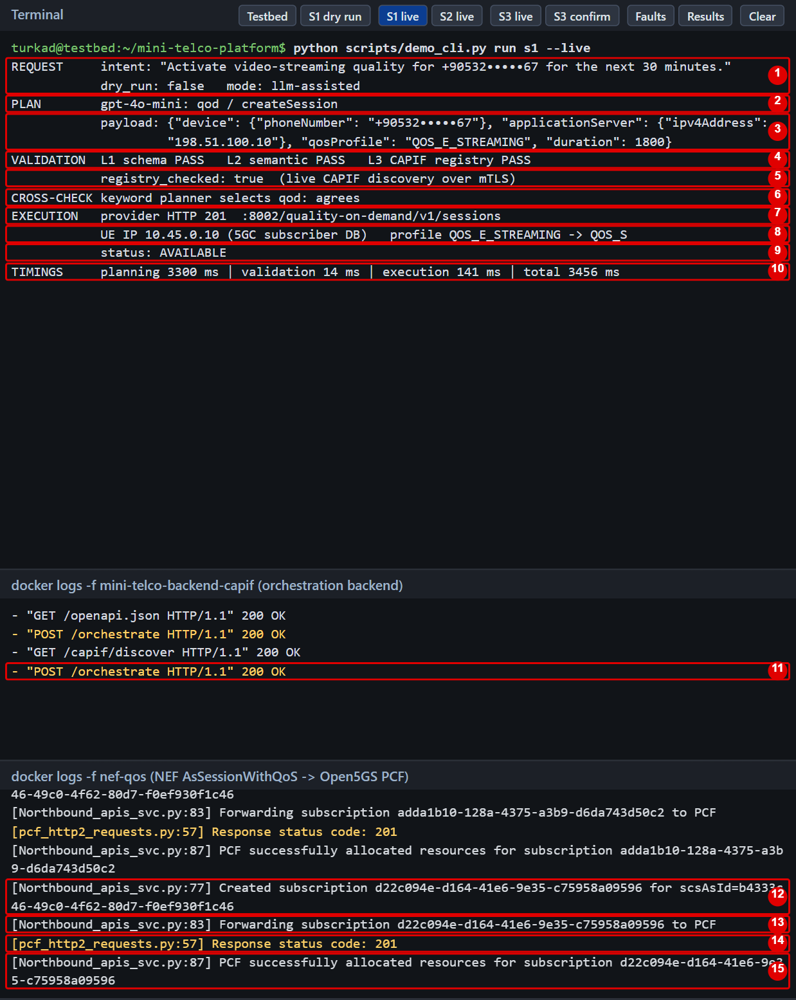
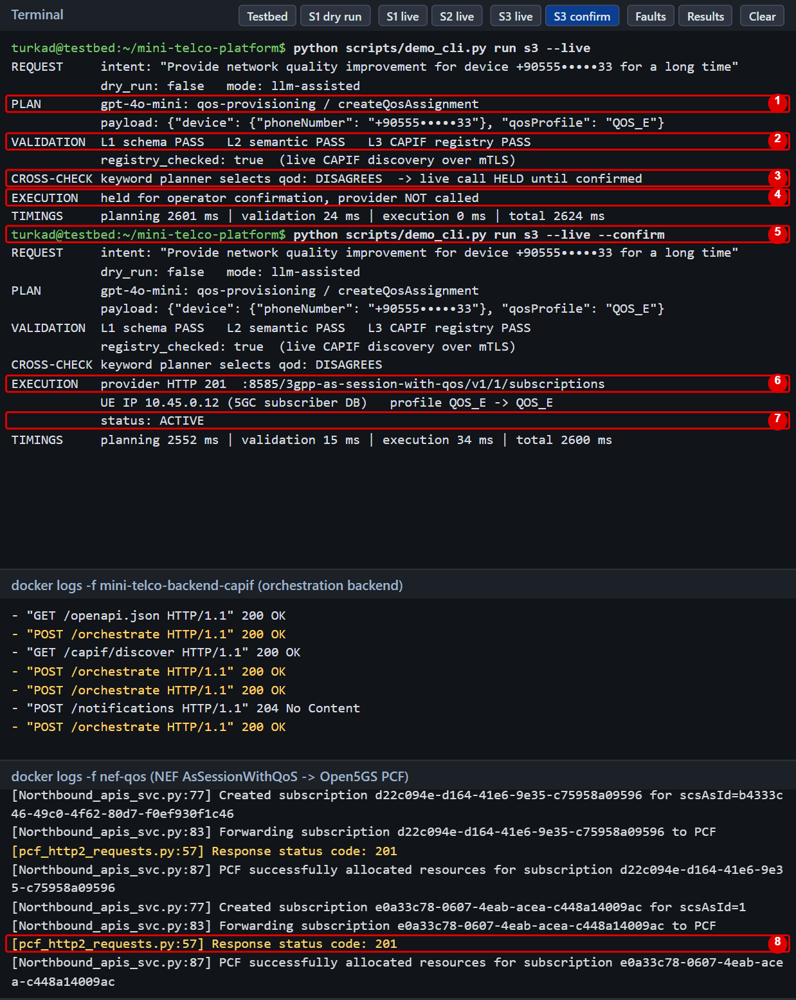
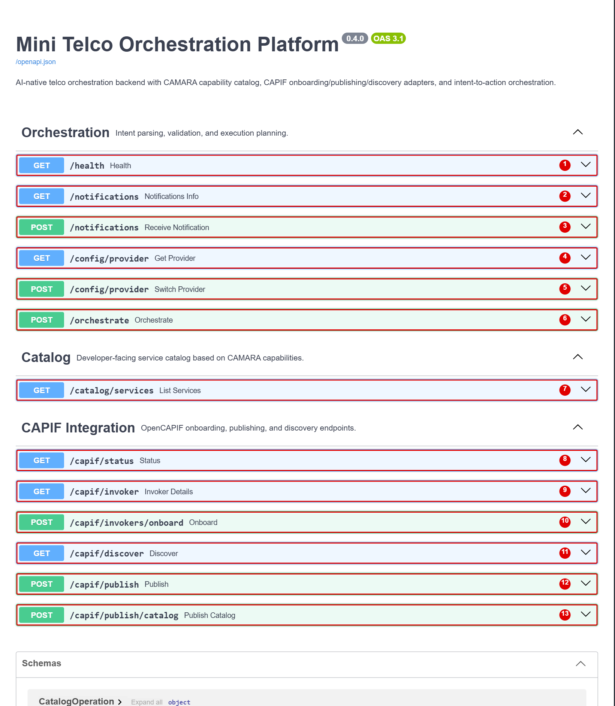
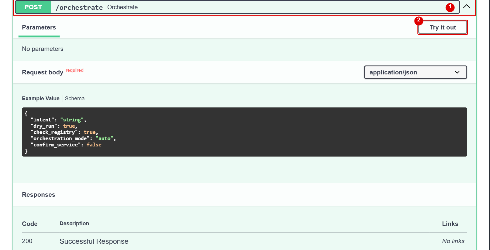
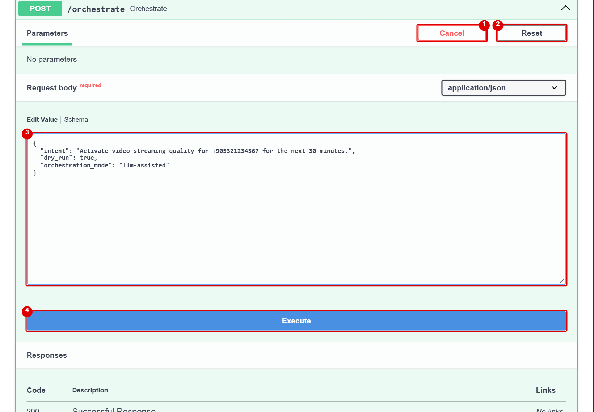
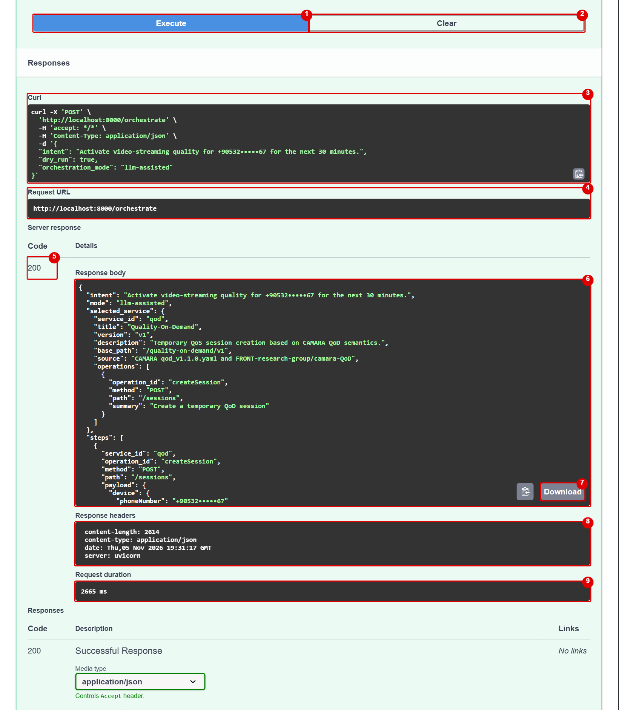
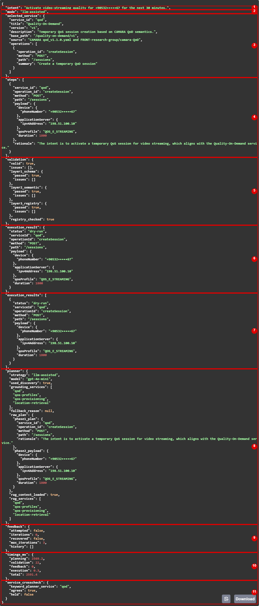

# Live console guide

What every part of the live console (http://localhost:8099) does. All screenshots are from the running
system; the red numbers match the tables. Start the system first with `bash scripts/demo_up.sh`
(see [SETUP_AND_USAGE.md](SETUP_AND_USAGE.md)).

## 1. The page

| # | Part | What it does |
|---|---|--- |
| 1 | Header | Page title; names the components that are running. It is only a label. |
| 2 | Clock | Current time (UTC), showing that the page is live. |
| 3 | API documentation (Swagger) | The backend's API page, http://localhost:8000/docs. Sends real requests. See sections 5–7. |
| 4 | Buttons | Each one runs a command on this computer. See section 2. |
| 5 | Terminal | Shows the command and its output, line by line. Scroll with the mouse wheel. |
| 6 | Backend log | Live `docker logs` of our backend: every request and its HTTP status. |
| 7 | NEF log | Live `docker logs` of NEF-QoS: QoS requests sent to the Open5GS PCF and its answer. |

## 2. The buttons

| # | Button | Command | What happens | Reaches the 5G core? |
|---|---|---|---|--- |
| 1 | Testbed | `demo_cli.py status` | Lists running containers, the APIs found in CAPIF, and the phones' IP addresses. No LLM call. | Only reads |
| 2 | S1 dry run | `demo_cli.py run s1` | "Video-streaming quality for 30 minutes": plans and validates, sends nothing. | No |
| 3 | S1 live | `demo_cli.py run s1 --live` | Closes that phone's old QoD session, then runs S1 through CAMARA QoD → NEF-QoS → PCF. | **Yes** |
| 4 | S2 live | `demo_cli.py run s2 --live` | Asks for a phone's location through CAMARA Location → NEF. The location data is emulated, and no PCF line appears. | NEF only |
| 5 | S3 live | `demo_cli.py run s3 --live` | Vague request ("for a long time"). The LLM picks QoS Provisioning, the keyword planner picks QoD, so the call is **held**. | No |
| 6 | S3 confirm | `demo_cli.py run s3 --live --confirm` | Same request sent with `confirm_service: true`. The LLM plans again, and the call goes directly to NEF-QoS → PCF. | **Yes** |
| 7 | Faults | `demo_cli.py faults --per-fault 1` | Breaks correct plans on purpose and shows which layer catches each fault (about 30 s). Provider calls are not made. | No |
| 8 | Results | `demo_cli.py results` | Prints the 300-intent results from the stored files. | No |
| 9 | Clear | – | Empties the terminal pane only. Nothing is stopped, and the logs stay. | No |

## 3. Reading the terminal: Testbed

| # | Output | Meaning |
|---|---|--- |
| 1 | Command line | The command the button started. |
| 2 | Running containers | How many containers run per group. |
| 3 | CAPIF discovery | Our backend is a CAPIF invoker and found 5 published APIs over mTLS. |
| 4 | UE PDU sessions | The three simulated phones and the IPs the 5G core gave them. |

## 4. Reading the terminal and the logs: live calls

### S1 live

| # | Output | Meaning |
|---|---|--- |
| 1 | REQUEST | The intent sent to `POST /orchestrate`; `dry_run: false` means live. The phone number is masked on screen. |
| 2 | PLAN | Planner phase 1: the model and the service and operation it chose. |
| 3 | payload | Planner phase 2: the JSON request the LLM wrote. |
| 4 | VALIDATION | Result of L1 (schema), L2 (telecom rules) and L3 (CAPIF registry). |
| 5 | registry_checked | `true`: L3 really asked OpenCAPIF. |
| 6 | CROSS-CHECK | The keyword planner's choice. `agrees` lets a live call continue. |
| 7 | EXECUTION | The CAMARA QoD provider answered HTTP 201. |
| 8 | UE IP, profile | Phone number resolved to the UE's IP from the subscriber database; streaming class mapped to the operator profile. |
| 9 | status | `AVAILABLE`: the QoD session is active. |
| 10 | TIMINGS | Time per stage. Planning is the LLM call. |
| 11 | Backend log | The backend received the request and answered 200. |
| 12 | Created subscription | NEF-QoS received the AsSessionWithQoS request. |
| 13 | Forwarding … to PCF | NEF-QoS sends it to the Open5GS PCF. |
| 14 | Response status code: 201 | **The PCF accepted it: the request reached the 5G core.** |
| 15 | PCF successfully allocated | NEF-QoS confirms the session. |

### S3 live, then S3 confirm

| # | Output | Meaning |
|---|---|--- |
| 1 | PLAN | The LLM chose QoS Provisioning. The expected answer in our dataset is QoD. |
| 2 | VALIDATION | All layers pass: the plan is valid and the service is published. They cannot tell that it may be the wrong service. |
| 3 | CROSS-CHECK | The keyword planner chose QoD, so the live call is held. |
| 4 | EXECUTION | Nothing was sent to the network. |
| 5 | `--confirm` | The second button: the operator confirms. |
| 6 | EXECUTION | NEF-QoS (port 8585) answered HTTP 201. Provisioning has no CAMARA provider in between. |
| 7 | status | `ACTIVE`: the assignment is active in the core. |
| 8 | NEF log | The PCF answered 201. |

## 5. API page: the endpoints

Click a row to open it. GET rows read information; POST rows send or change something.

| # | Endpoint | What it does |
|---|---|--- |
| 1 | `GET /health` | Is the backend running? |
| 2 | `GET /notifications` | Describes the callback receiver. |
| 3 | `POST /notifications` | Receives callbacks from CAPIF and the providers. You do not call it by hand. |
| 4 | `GET /config/provider` | Which LLM is active. |
| 5 | `POST /config/provider` | Switches the LLM: `{"provider": "openai"}`, `"anthropic"` or `"gemini"`. |
| 6 | `POST /orchestrate` | **The main endpoint:** intent in, validated (and optionally executed) API call out. |
| 7 | `GET /catalog/services` | The four CAMARA services and their operations. |
| 8 | `GET /capif/status` | Connection to OpenCAPIF and certificates. |
| 9 | `GET /capif/invoker` | Our identity in CAPIF. |
| 10 | `POST /capif/invokers/onboard` | Registers the backend in CAPIF. `start.sh` does this. |
| 11 | `GET /capif/discover` | The APIs published in CAPIF. |
| 12 | `POST /capif/publish` | Publishes one service in CAPIF. |
| 13 | `POST /capif/publish/catalog` | Publishes the catalog in CAPIF. |

## 6. API page: sending a request

### Open the endpoint

| # | Part | What it does |
|---|---|--- |
| 1 | Endpoint row | Opens and closes the endpoint. |
| 2 | Try it out | Makes the request body editable. |

### Write the request

| # | Part | What it does |
|---|---|--- |
| 1 | Cancel | Leaves edit mode. |
| 2 | Reset | Restores the example body. |
| 3 | Request body | The request. `intent`: the sentence. `dry_run`: `true` sends nothing, `false` executes. `orchestration_mode`: `llm-assisted` or `deterministic`. |
| 4 | Execute | Sends the request to the backend. |

### Read the response

| # | Part | What it does |
|---|---|--- |
| 1 | Execute | Sends again. |
| 2 | Clear | Removes the response from the page. Nothing changes in the system. |
| 3 | Curl | The same request as a terminal command. |
| 4 | Request URL | The address that was called. |
| 5 | Code | HTTP status: 200 OK; 422 still invalid after three corrections; 502 LLM failed; 503 live call refused because CAPIF is unreachable. |
| 6 | Response body | The result in JSON. See section 7. |
| 7 | Download | Saves the response as a file. |
| 8 | Response headers | Technical HTTP headers. |
| 9 | Request duration | Total time seen by the browser. |

The "Responses" section below these (Example Value, Schema) is fixed documentation, not your result.

## 7. API page: the response, field by field

Example: S1 with `dry_run: true`.

| # | Field | Meaning |
|---|---|--- |
| 1 | `intent` | The request as received. |
| 2 | `mode` | Which planner produced the plan. |
| 3 | `selected_service` | Catalog entry of the chosen service. |
| 4 | `steps` | The plan: operation, `payload` and the LLM's `rationale`. |
| 5 | `validation` | Result and issues of L1, L2, L3, plus `registry_checked`. |
| 6 | `execution_result` | What execution did: `dry-run`, `created`, `ok`, `held-for-confirmation` or `provider-error`. |
| 7 | `execution_results` | The same for every step (requests with several parts). |
| 8 | `planner` | `model`, whether the CAPIF list was used, and the raw LLM outputs. |
| 9 | `feedback` | Whether the LLM had to correct the plan, and the correction history. |
| 10 | `timings_ms` | Milliseconds per stage. |
| 11 | `service_crosscheck` | The keyword planner's choice, `agrees`, and `held`. |
